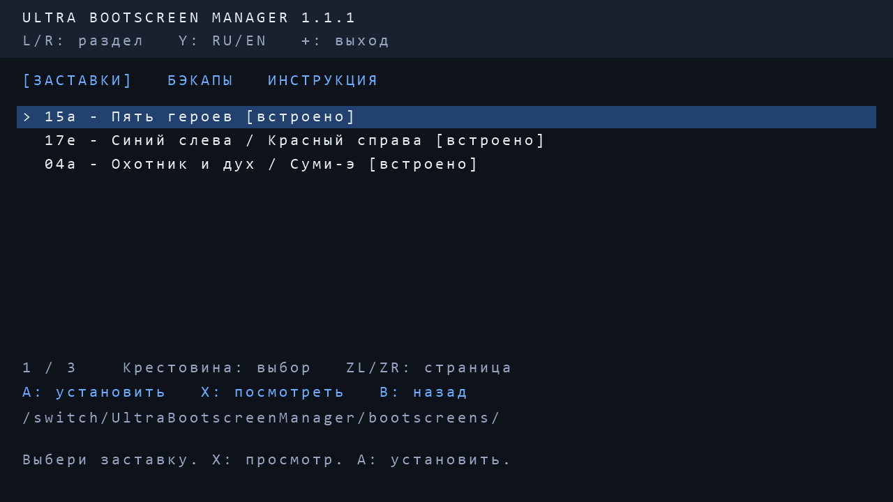
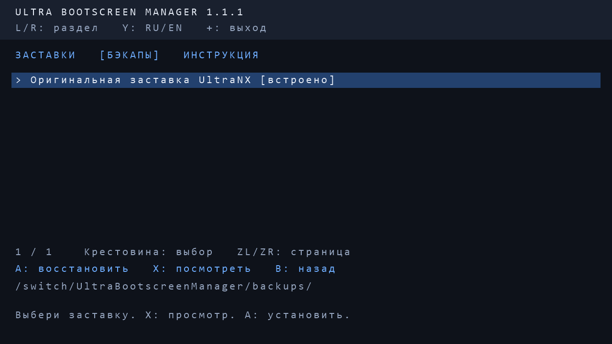
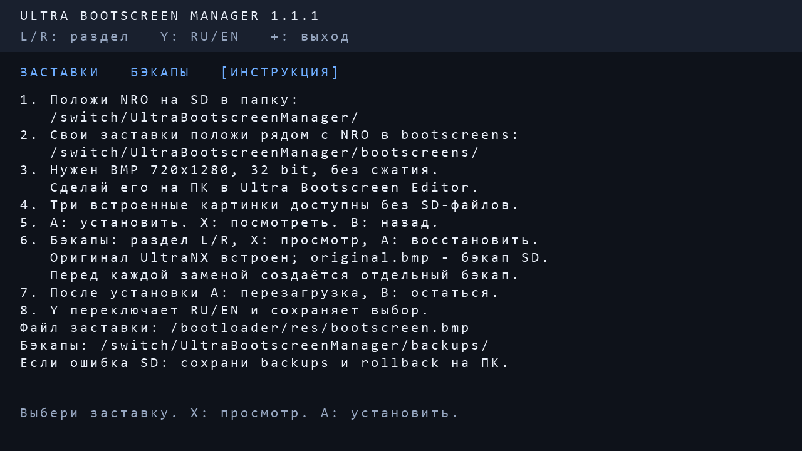
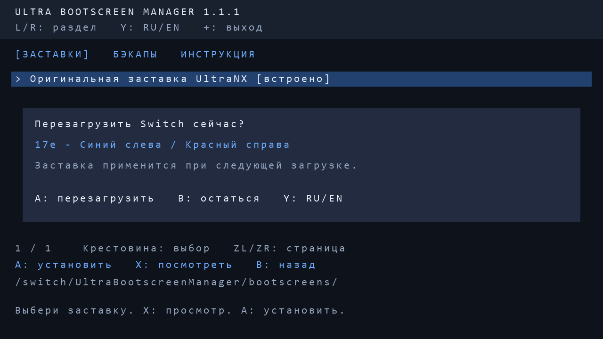

# Ultra Bootscreen Manager 1.1.1

Switch homebrew для смены заставки UltraNX. Русский и английский интерфейс,
предпросмотр заставок и бэкапов, восстановление и предложение перезагрузиться.
Встроены 15a-five-hero-lineup, 17e-flat-split-duel и 04a-hunter-spirit-sumie.

[Скачать релиз 1.1.1](https://github.com/jeronimo701/ultra-bootscreen-manager/releases/tag/v1.1.1).
Автор приложения: Jeronimo701. Это самостоятельный homebrew-проект,
не официальный продукт Nintendo или UltraNX.

## Скриншоты

Снимки реального рендера интерфейса в тестовом окружении на ПК, 1280×720.
Это не фотографии и не захват с физической Switch. Сервисы консоли в тестах имитируются.






[Меню на английском](docs/screenshots/menu-en.png).

## Установка на SD

Скачай `UltraBootscreenManager.nro` из Releases. На SD создай папку
`switch/UltraBootscreenManager` и положи NRO в неё. Если используешь готовую
папку релиза, скопируй её папку `switch` в корень SD. Структура:

```
switch/UltraBootscreenManager/
    UltraBootscreenManager.nro
    bootscreens/                  <- свои заставки BMP
    backups/                      <- создаётся автоматически
    language.txt                  <- создаётся при смене языка
```

Запусти приложение через hbmenu. Для трёх встроенных заставок отдельные
картинки не нужны. Свои картинки подготовь в Ultra Bootscreen Editor:
BMP 720×1280, 32 bit, без сжатия, с поворотом под UltraNX.
Обычные JPG/PNG непосредственно в NRO не конвертируются.
В bootscreens можно класть BMP с любыми именами, без переименования в bootscreen.bmp.
Вложенные папки не сканируются; предел списка — 512 записей.
Для имён файлов рекомендуются латиница, цифры или кириллица.

## Управление

- Y: переключить RU/EN; выбор сохраняется.
- L/R: разделы «Заставки», «Бэкапы», «Инструкция».
- Вверх/вниз: выбор; ZL/ZR: переход на 10 записей.
- X: полноэкранный просмотр выбранной заставки или бэкапа.
- B/X/+ при просмотре: вернуться в меню.
- A: установить заставку или восстановить выбранный бэкап; ещё раз A — подтвердить.
- После успешной установки/восстановления: A — перезагрузиться, B — остаться.
- B: отменить подтверждение; из других разделов вернуться к заставкам.
- + в меню: выход в hbmenu.

Инструкция доступна и внутри приложения. Перезагрузка выполняется только
после отдельного подтверждения. Если сервис перезагрузки недоступен,
появится сообщение: перезагрузи консоль вручную.

## Бэкапы и безопасность

Приложение меняет только `sdmc:/bootloader/res/bootscreen.bmp`.
Бэкапы: `sdmc:/switch/UltraBootscreenManager/backups/`.
Первым в разделе «Бэкапы» стоит «Оригинальная заставка UltraNX [встроено]»:
точная копия предоставленного bootscreen.bmp, доступная даже без бэкапов на SD.
X — посмотреть, A — восстановить с подтверждением. Текущая заставка сначала
сохраняется в бэкап; после восстановления предлагается перезагрузка.
`original.bmp` — автоматический бэкап первой заставки с SD, он не перезаписывается.
Это отдельный файл, он не подменяется встроенным оригиналом UltraNX.
Перед каждой заменой, включая восстановление, создаётся отдельный
`previous-ДАТА-ВРЕМЯ-НОМЕР.bmp`. Остальные бэкапы сортируются от новых к старым.

Запись проверяется сравнением содержимого. При обычной ошибке установки
выполняется откат. После прерывания rollback-файл восстанавливается, если
основной отсутствует. Если оба файла существуют, запись блокируется:
сначала сохрани их и папку backups на ПК и проверь SD.
Отключение питания и повреждение FAT не позволяют гарантировать восстановление.
Бэкапы на SD не заменяют копию на ПК. Не вынимай SD и не выключай консоль при записи.

## Проверка и сборка

NRO собран для AArch64 с `-Wall -Wextra -Werror`. Проверены структура NRO,
RomFS и контрольные суммы четырёх BMP и шрифта. 22 проверки на ПК прошли:
установка, восстановление, ошибки записи, recovery, списки, язык и кнопки.
Сервисы Switch в этих тестах имитируются. На реальной Switch версия ещё не проверена.

PowerShell: `./build.ps1 -Toolchain 'C:/devkitPro'` (либо задай переменную
`DEVKITPRO`; без неё путь по умолчанию — `C:/devkitPro`).
Нужен Windows PowerShell с System.Drawing для генерации кириллического шрифта.
Использованы devkitA64 GCC 16.1.0, libnx 4.12.0, switch-tools 1.13.1.
Результат: `UltraBootscreenManager.nro`.

Тесты на Windows: `./test.ps1 -Zig 'C:/tools/zig/zig.exe'`.
Тесты пишут только в локальную папку `verification`, а не на настоящую SD;
они также генерируют BMP-снимки интерфейса.

Повторная сборка при подготовке публичного релиза побайтово совпала с исходным
NRO версии 1.1.1. 22 проверки на ПК прошли повторно. См. [VALIDATION.md](VALIDATION.md).

## Авторство и сторонние компоненты

Приложение опубликовано по запросу автора. Отдельная лицензия на собственный код
пока не выбрана: открытый доступ к репозиторию сам по себе не даёт лицензии
на произвольное переиспользование. Лицензии зависимостей действуют отдельно:
[THIRD-PARTY.md](THIRD-PARTY.md).

## English quick start

Download the NRO from Releases, place it in `/switch/UltraBootscreenManager/`
on the SD card and launch via hbmenu. Press Y for English.
Put compatible 720×1280 uncompressed 32-bit BMPs in
`/switch/UltraBootscreenManager/bootscreens/` next to the NRO.
Use Ultra Bootscreen Editor on PC to convert JPG/PNG and apply the required rotation.
L/R switches Bootscreens / Backups / Help; X previews, A installs/restores
with confirmation. After success, A reboots and B stays. + exits.
The Backups tab includes the embedded original UltraNX bootscreen (available
without SD backups). The automatic first SD backup and dated backups remain separate.
Back up the SD on PC; hardware testing is still required.
